# PlantGeek - DIY Climate Chamber Platform Manual

<div align="center">
  
</div>

**Created by Mathias Pechinger**  
**🔴 BETA VERSION - Version 0.1.0**

---

## Table of Contents

1. [Introduction](#introduction)
2. [Disclaimer](#disclaimer)
3. [Components Required](#components-required)
4. [Preparing the Fridge](#preparing-the-fridge)
5. [Installation](#installation)
6. [Regular Maintenance and Testing Checklist](#regular-maintenance-and-testing-checklist)
7. [FAQ - Troubleshooting](#faq---trouble-shooting)
8. [Appendix](#appendix)

---

## Introduction

This manual provides a comprehensive guide for building your DIY climate chamber platform for plant growth. This platform uses a Raspberry Pi and Zigbee smart home devices, allowing precise control over environmental parameters such as temperature, humidity, and CO₂ levels. Please follow this guide to assemble and configure the system for the best results.

**Make sure to check the quick-start video:** [https://youtu.be/ruVc4RdbNsQ](https://youtu.be/ruVc4RdbNsQ)

---

## Disclaimer

**⚠️ IMPORTANT NOTICE**

This manual is provided as a guide for creating a DIY project and is intended for informational purposes only. By following this manual, you acknowledge and agree to the following:

- This is a **DIY (Do-It-Yourself)** project, and the instructions are provided without any guarantees or warranties, express or implied, regarding accuracy, completeness, or suitability for any specific purpose.
- The author and contributors of this manual are not liable for any damage, loss, or injury resulting from using this manual or the device built using these instructions.
- Users undertake this project entirely at their own risk, including but not limited to:
  - Electrical safety risks, including potential for electric shock
  - Damage to property or equipment caused by improper assembly or use
  - Health risks to plants or individuals due to environmental control failures
- It is the user's responsibility to ensure proper safety measures are followed, including compliance with local laws and regulations regarding electrical devices and installations.
- This project is not intended for commercial use or any application where failure could result in significant harm or damage.

**By proceeding with this manual, you accept full responsibility for any outcomes resulting from the assembly, use, or modification of the described system.**

---

## Components Required


| Component | Model / Type | Notes |
|-----------|--------------|-------|
| Raspberry Pi | Raspberry Pi 5 (4 GB) | Older versions may also work |
| Cooler for Raspberry Pi | Optional | System was not tested without it |
| Power Supply for Raspberry Pi | Official Raspberry Pi Power Supply | Less powerful supplies may work; this one is tested |
| Camera | Any compatible Raspberry Pi Camera | Setup might differ; check GitHub README |
| Camera Cable | Compatible with Pi 5 | Requires smaller CSI cable interface for Pi 5 |
| Zigbee Coordinator | ZBDongle-P or Conbee 3 | Avoid cheaper alternatives; tested with recommended models |
| Zigbee Sockets | Ledvance sockets | Tested for several months |
| Environment Sensor | SCD40 (or SCD41) | SCD41 has higher accuracy; SCD40 is sufficient for this task |
| Pressure Regulator | Soda Stream, compatible regulator | Avoid cheaper alternatives for reliability |
| Grow Light | 100 watts grow light | Tested with Spiderfarmer and previously 100W Sanlight which is discontinued |
| Fans (2x) | Suitable for airflow | Currently under testing |
| Power Strip | Provides power to fans and other components | Necessary for fan setup |
| CO₂ Bottle | Soda Stream bottle | May be available at a lower price at local stores |
| Mounting Grid | Used for mounting | Ideal for securing components with zip ties |
| Heater | LightHouse ECOHEAT or similar | Specific component; heating mats may add clutter. Avoid fan heaters due to safety concerns |
| Cable Mounts | For fan and cable organization | Helps secure and organize cables |
| Temperature Fallback Relay | Safety device | Adds safety to prevent overheating |

---

## Preparing the Fridge

### Selecting the Right Fridge

You can choose a fridge that suits the type and size of plants you intend to grow. A compact fridge suffices for smaller herbs like basil, while larger plants may require more space. Ensure the refrigerator has adequate power; smaller models might need an additional fan installed at the rear to enhance airflow. The **"OK. OFR 311 E"** fridge is recommended for its moderate size and reliable performance.

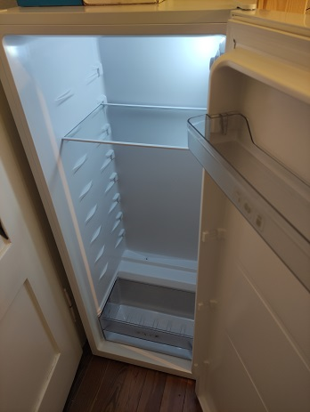
*Figure: Fridge before conversion*

### Preparing the Fridge Interior

Remove all internal components except the bottom tray, which will hold the plants. Install a sheet metal panel on the back wall to collect condensation. This setup addresses two issues:

- Reduces the frequency of watering by recycling condensed water
- Prevents the fridge's rear collector from being overwhelmed by excess condensation

You can quickly get such a sheet metal in your local hardware store. If you want to be tidy, ask them to cut it in the right size for you.

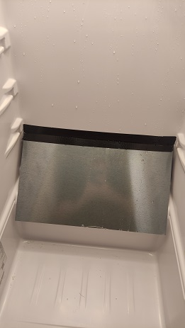
*Figure: Installed sheet metal on rear wall*

### Creating an Access Point for Power

To supply power to internal components, create an opening at the top of the fridge. The opening does not have to be very large. Using the power strip from the part list, we can free up the power cord and put it through a small hole. The following figure shows the cables lined through the top. In addition, the cable for the Raspberry Pi (thin white) and the temperature sensor (thin black) for the additional safety relay can be seen.

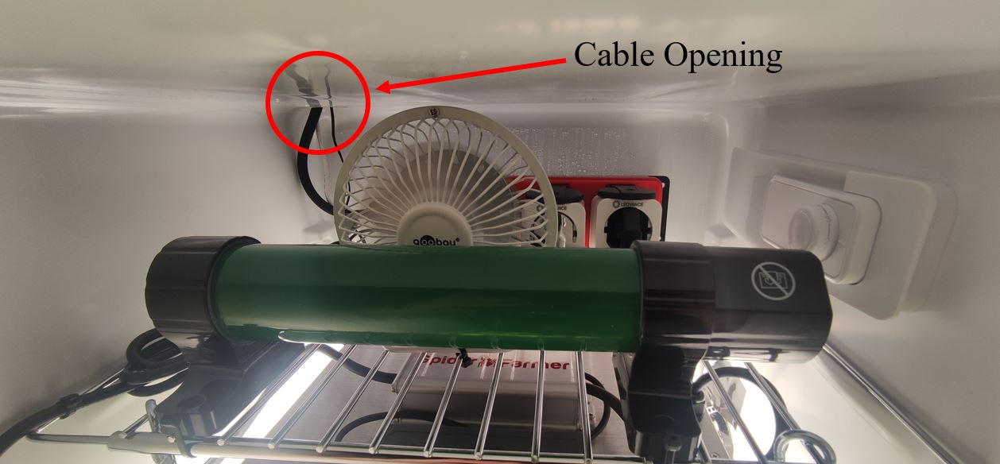
*Figure: Electronics compartment. On the left, the cable feed-through can be seen.*

**Note:** The power strip given in the part list can be opened with a screwdriver, and the power wires can be disconnected.

**⚠️ WARNING:** This procedure involves handling electrical components and should only be performed by qualified personnel. Ensure the power strip is disconnected from any power source before opening it. Improper handling of this step poses a significant risk of electric shock and serious injury. Always exercise caution and prioritize safety.

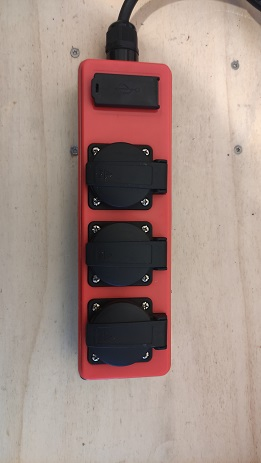 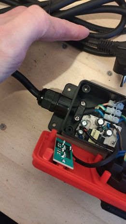
*Figure: The opened power strip*

### Installing Components on the Top Tray

Mount a metal tray at the top of the fridge. Attach the multi-socket and Zigbee sockets at the rear end. Secure a fan using zip ties, and position a heater before it to ensure even heat distribution throughout the fridge.

**Note:** Make sure the heater does not touch any components; this could be dangerous and is also mentioned by the supplier of the heater. The heater in our system is chosen so that it never gets any hotter than you could not touch it. So it is designed to be safe, but we do not want to rely on that, so mount it rigid on the metal tray that is recommended by us, given in the part list.

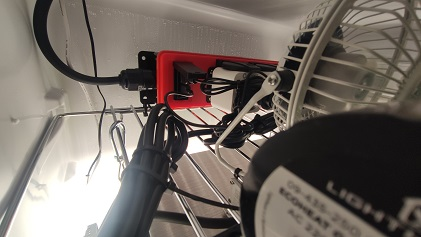
*Figure: Electronics compartment. Detail view USB connection*

### Outside Power Setup

For additional safety, we have a power setup outside the fridge that includes an additional temperature relay. The power strip can be seen in the following figure. On the left side, the fridge is connected in the middle, the temperature relay, and on the right, the power for the Raspberry Pi. Setup the temperature relay to shut down your whole system at your desired temperature (In this case, 35.0°C).

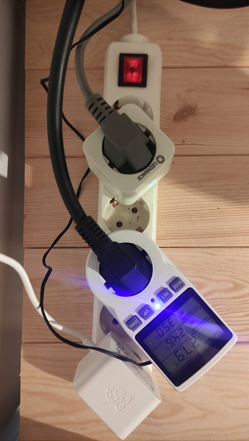
*Figure: Power strip outside of the fridge, showing how components are connected*

The temperature relay is an additional fallback level if your system has critical issues. After all, this is DIY, and we learn stuff that might sometimes result in mistakes. Still, we do not want to damage our plants or devices by raising the temperature to critical levels. Please also ensure the relay works by holding the temperature sensor in hot water; you should see that your system turns off. It acts by shutting down the CO₂ valve, heater, and light. This leads to a safe state, as no more power is introduced into the system.

### CO₂ Valve

Connect the CO₂ Valve to your CO₂ Bottle and connect the power output to your Zigbee socket.

**⚠️ WARNING:** Put your CO₂ bottle in an upright position. The CO₂ is highly pressurized and, therefore, liquid. The liquid must not come in contact with the valve, or it will get damaged. This is dangerous.

---

## Installation

If you want, follow along with the video provided by us at [https://youtu.be/ruVc4RdbNsQ](https://youtu.be/ruVc4RdbNsQ)

### Installing the Raspberry Pi Image

Follow these instructions to install a basic Raspberry Pi image:

1. **Download the Raspberry Pi Imager** from [https://www.raspberrypi.com/software/](https://www.raspberrypi.com/software/)

2. **Install the image** onto your SD card

   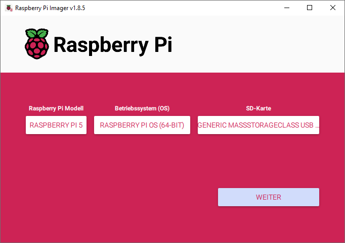
   *Figure: Raspberry Pi Image Installation*

3. **Open the Settings menu** and edit it

   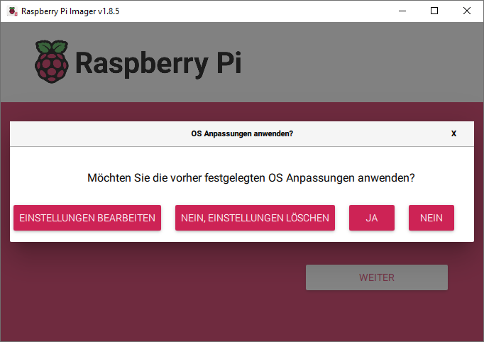
   *Figure: Wi-Fi Setup*

4. **Configure the system:**
   - Choose the hostname "plantgeek" and user "plantgeek"
   - Set up a password and don't forget it, as you will need it later
   - Set up your Wi-Fi connection during installation (recommended 5GHz Wi-Fi) so your Raspberry Pi can join your home network without needing to connect any keyboard, screen, etc.

   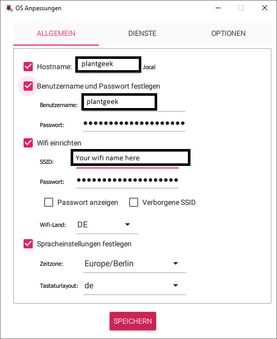
   *Figure: Wi-Fi Setup Confirmation*

5. **Activate SSH access** using a password, so we can connect to it

   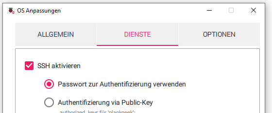
   *Figure: SSH Setup*

6. **Insert the SD card** into your Raspberry Pi

### Sensor Connection

**Environment Sensor:** Currently, the SCD4x sensor is supported. Connect the sensor to the Raspberry Pi as shown in the existing connection diagram. Our dedicated PCB can also be used, so you don't have to use a wired sensor. Ask the developers about this part on beta@plantgeek.de, as this part is currently being tested.

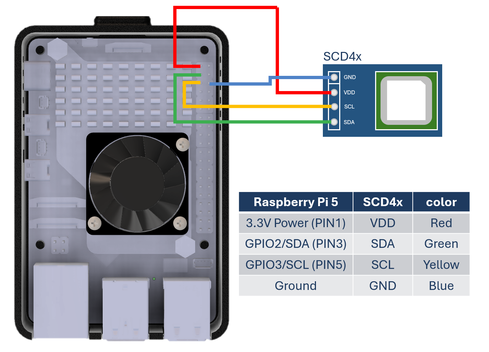

**Note:** The SCD41 is tested and recommended. The SCD40 is also fine as a cheaper but less accurate option.

**Camera:** Connect a camera using the CSI interface. Use the Cam/Disp0 interface port on your Raspberry Pi. Note that USB cameras are no longer supported due to reliability issues.

### Zigbee Gateway Connection

Plug in your Zigbee USB stick. We recommend the Sonoff Zigbee bridge.

### Software Installation

1. **Connect your Raspberry Pi** to its power supply

2. **Log in via SSH** after booting up (wait about 3 minutes). You can start an SSH connection on Windows using "Windows PowerShell," which can be found using the basic Windows search. Note: on first login, it will ask for the fingerprint. You can type "yes" and continue.

   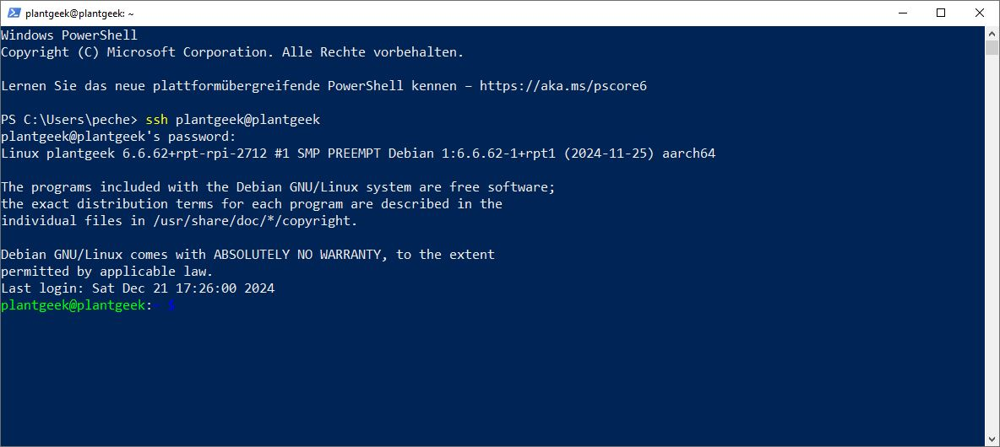
   *Figure: SSH connection example*

   ```bash
   ssh plantgeek@plantgeek
   ```

3. **Clone the repository:**
   ```bash
   mkdir plantgeek
   cd plantgeek
   git clone https://github.com/MathiasPechinger/plantgeek.git .
   ```

4. **Run the setup script:**
   ```bash
   ./setup.sh
   ```
   
   **Note:** The setup script will do all installation steps for you. After it is completed, there is nothing else you have to do from here. The rest can be done from the frontend.

5. **Access the app** via your browser at `http://plantgeek:5000/`

### Connecting Zigbee Devices

When interacting with the Zigbee sockets, you have to start by connecting them to your system. PlantGeek incorporates the zigbee2mqtt interface, which can be accessed using the browser URL `http://plantgeek:8080/`. There you can click on "Permit join" and connect your devices.

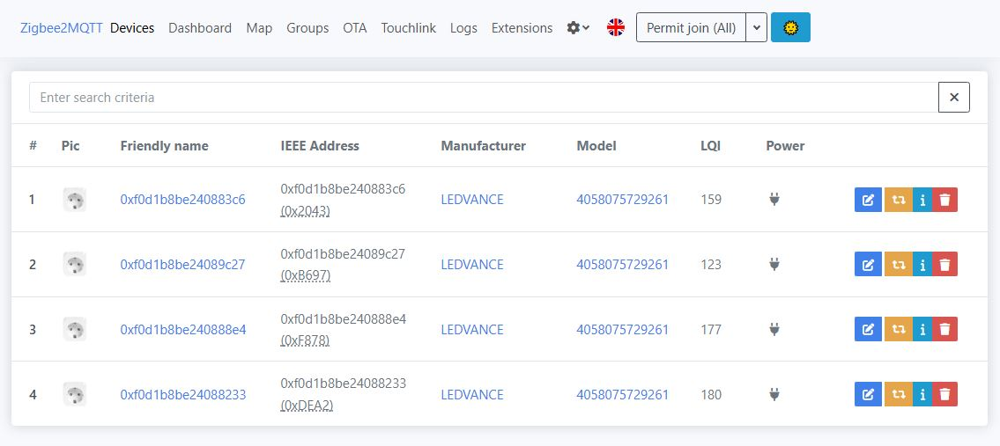
*Figure: Zigbee2mqtt web interface*

When you are done connecting, you will also see them in the PlantGeek frontend (`http://plantgeek:5000/`)

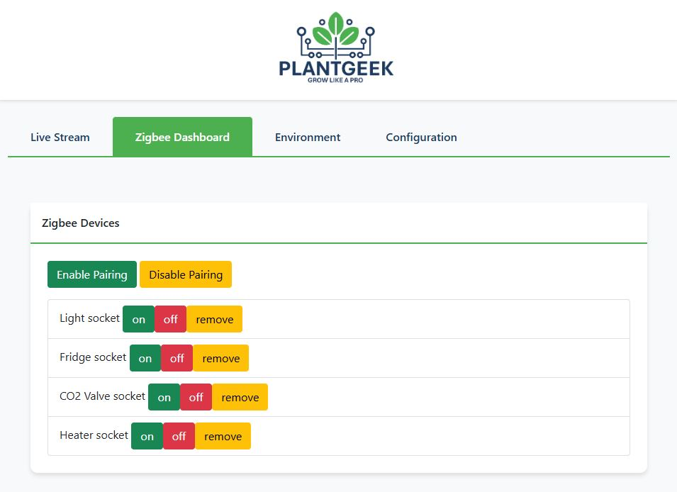
*Figure: PlantGeek frontend showing connected Zigbee devices*

---

## Regular Maintenance and Testing Checklist

The system is designed to account for different malfunctions. We have done a failure mode and effect analysis (FMEA) to ensure our system is safe. In addition, we do thorough testing of the safety features of our system. Nevertheless, this is a DIY project, and you are responsible for the safety of your device. We have provided a list of regular checks that help you manage possible safety issues:

### 1. Raspberry Pi Power and Communication
- **Action:** Simulate a power failure by disconnecting the Raspberry Pi's power supply
- **Expected Outcome:** All Zigbee sockets should automatically shut down after 60 seconds of no communication
- **Frequency:** Monthly

### 2. Zigbee Socket Communication
- **Action:** Manually disconnect the Zigbee gateway from the Raspberry Pi
  - **Fridge Socket:** Ensure the fridge turns off after a timeout
  - **CO₂ Socket:** Ensure CO₂ generation stops after timeout
  - **Light Socket:** Ensure the light shuts off after a timeout
  - **Heater Socket:** Ensure the heater turns off after a timeout
- **Expected Outcome:** Each device should enter a safe state within the timeout period
- **Frequency:** Monthly

### 3. CO₂ Sensor (SCD40/41)
- **Action:** Simulate a sensor failure by disconnecting the CO₂ sensor
- **Expected Outcome:** The system should trigger a `SENSOR_DATA_NOT_UPDATED` error, and all devices should shut down
- **Frequency:** Quarterly
- **Additional Check:** Observe sensor accuracy by comparing its readings with a reference device

### 4. System Overheating

#### 4.1 External Relay
- **Action:** Use an external heat source to gradually raise the system's temperature above the critical threshold (e.g., 35°C)
- **Expected Outcome:** The temperature relay should cut power to the heater and light, and the system should log a `SYSTEM_OVERHEATED` error
- **Frequency:** Quarterly

#### 4.2 Internal Sensor SCD40/41
- **Action:** Use an external heat source to gradually raise the system's temperature above the critical threshold (e.g., 35°C)
- **Expected Outcome:** The system should shut down the light and the heater with a `SYSTEM_OVERHEATED` error
- **Frequency:** Quarterly

### 5. General System Behavior
- **Action:** Observe the system's overall behavior under typical operating conditions, looking for anomalies such as unexplained power usage, unresponsive devices, or irregular environmental control
- **Frequency:** Weekly

### User Notes
- Please always make sure the system is disconnected from the power supply when performing physical checks on components
- Log all test results and errors for future reference and troubleshooting
- Replace components (e.g., sensors, relays) immediately if any failures occur during tests

---

## FAQ - Trouble Shooting

### Backend Troubleshooting and Additional Notes

#### Checking System Status
```bash
sudo systemctl status drowbox_webapp.service
```

#### Manually Running the Web App
```bash
sudo systemctl stop drowbox_webapp.service
source venv/bin/activate
python app.py
```

#### Troubleshooting Zigbee Connectivity
If you're in an urban area with channel interference, you can change the transmission channel at `plantgeek:8080`.

#### Increasing Swap Size for Low-RAM Devices
For devices with less than 4GB RAM:
```bash
sudo nano /etc/dphys-swapfile
```

Change the line:
```
CONF_SWAPSIZE=1024
```

#### Conbee 3 Setup
To use the Conbee 3 gateway, modify `zigbee2mqtt.yaml` to include:
```yaml
adapter: deconz
baudrate: 115200
```

#### Older Raspberry Pi Cameras (e.g., IMX219) Setup
Edit the configuration file:
```bash
sudo nano /boot/firmware/config.txt
```

For IMX219 cameras, add:
```
camera_auto_detect=0
dtoverlay=imx219,cam0
```

For OV5647 cameras, add:
```
camera_auto_detect=0
dtoverlay=ov5647
```

[Source: ArduCam Documentation](https://docs.arducam.com/Raspberry-Pi-Camera/Native-camera/8MP-IMX219/)

---

## Appendix

### Failure Mode and Effects Analysis (FMEA)

#### Key Definitions
- **Severity (1-10):** Impact of the failure on system operation and safety
- **Likelihood (1-10):** Probability of the failure occurring
- **Detection (1-10):** Ability to detect the failure before it impacts the system
- **Risk Priority Number (RPN):** Calculated as Severity × Likelihood × Detection

### FMEA Table

| Part | Failure Mode | Effect on System | Severity | Likelihood | Detection | RPN | Mitigation / Action Plan |
|------|--------------|------------------|----------|------------|-----------|-----|--------------------------|
| Raspberry Pi | Power failure (loss of power) | System stops functioning, no control over devices | 10 | 4 | 9 | 360 | A timeout is included in the message to the Zigbee sockets. If no message is received for 60 seconds, the sockets shut down themselves. |
| Zigbee Socket (Fridge) | Loss of communication with Raspberry Pi | Fridge does not respond to control signals, possibly causing temperature rise | 9 | 5 | 7 | 315 | Implement a timeout in Zigbee sockets; ensure all sockets shut down if communication loss persists. |
| Zigbee Socket (CO₂) | Loss of communication with Raspberry Pi | CO₂ generation stops, affecting air quality, potentially damaging plant growth | 9 | 5 | 7 | 315 | Implement a timeout in Zigbee sockets; ensure all sockets shut down if communication loss persists. |
| Zigbee Socket (Light) | Loss of communication with Raspberry Pi | Light does not respond, affecting plant growth. Control over light may be lost if no data update occurs, causing overheating. | 8 | 5 | 7 | 280 | Implement a timeout in Zigbee sockets; ensure all sockets shut down if communication loss persists; additional temperature-triggered relay to cut the power in case of high temperature. |
| Zigbee Socket (Heater) | Loss of communication with Raspberry Pi | Heater fails to respond, risking inadequate heating or overheating | 9 | 5 | 7 | 315 | Implement a timeout in Zigbee sockets; ensure all sockets shut down if communication loss persists; additional temperature-triggered relay to cut the power in case of high temperature. |
| SCD40 CO₂ | Sensor failure (e.g., inaccurate readings, disconnected sensor) | Incorrect CO₂ readings affect air quality control, potentially harming plants | 9 | 3 | 8 | 216 | Implement sensor health monitoring, fallback strategies, and sensor replacement. Trigger `SENSOR_DATA_NOT_UPDATED` error if disconnected. |
| SCD40 Sensor Data Frozen | Sensor data freeze (sensor provides stale data) | The control system uses outdated data, leading to improper decisions in temperature, humidity, or CO₂ control | 9 | 4 | 8 | 288 | Detect frozen sensor data and trigger `TEMPERATURE_SENSOR_FROZEN` error. Shut down all devices if no updated data is received. |
| Zigbee Network (All Devices) | Zigbee network failure (packet loss, interference) | Loss of control over all Zigbee devices, leading to failure in controlling the fridge, CO₂, heater, or light | 10 | 3 | 8 | 240 | Implement a watchdog timer for Zigbee communication. If no updates from any socket are received, shut down all devices. |
| System Overheating | Excessive temperature (overheating) without malfunction of heater/lamp | Safety concern: overheating of the system without failure of heater or lamp (due to external factors) | 10 | 2 | 9 | 180 | Add a temperature relay socket to shut down the heater and light in the event of overheating (external cause). Trigger `SYSTEM_OVERHEATED` error, shutting down the lamp and heater. |
| Control Software | Algorithm failure or software bug leading to improper decision-making | Incorrect control of devices, leading to unsafe environmental conditions for plants (e.g., wrong heating, CO₂, or light) | 10 | 4 | 6 | 240 | Implement software error handling; real-time monitoring of decision outputs; testing of safety functions in all scenarios. |
| Temperature Sensor Failure | Fault in temperature sensor (incorrect readings or disconnected) | Incorrect temperature control, potentially causing underheating or overheating | 9 | 3 | 8 | 216 | Use redundant temperature sensors; trigger an error like `TEMPERATURE_SENSOR_INVALID` if failure detected. |
| System Monitoring and Alerts | Alert system failure (incorrect or missed alerts) | Failure to notify user of issues (e.g., CO₂ levels too high, system overheating) | 8 | 3 | 7 | 168 | Implement error handling for alert generation; ensure critical alerts are sent and logged correctly. |

---

**End of Manual**

*This documentation is part of the PlantGeek project by Mathias Pechinger. For support and updates, visit [GitHub](https://github.com/MathiasPechinger/plantgeek) or contact beta@plantgeek.de* 